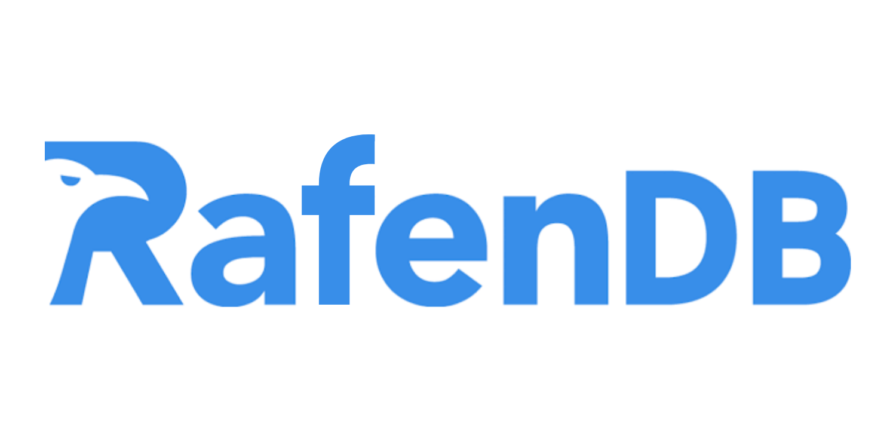

# RafenDB



Yes, you're right! **A mini Database Management System (mDBMS) from scratch.**

## Overview

| Component                   | Package                   | Group |
|-----------------------------|---------------------------|-------|
| Query Processor             | `org.rafendb.processor`   | G1    |
| Concurrency Control Manager | `org.rafendb.concurrency` | G2    |
| Query Optimizer             | `org.rafendb.optimizer`   | G3    |
| Storage Manager             | `org.rafendb.storage`     | G4    |
| Failure Recovery Manager    | `org.rafendb.recovery`    | G5    |

## Quick start

You need JDK 25 or newer. Maven is optional: `./mvnw` downloads the pinned version.

```bash
./mvnw verify                         # format, compile, test, package
scripts/run.sh server                 # start the server
scripts/run.sh client                 # connect a CLI client
scripts/run.sh driver <component>     # interactive driver for one component
```

On Windows use `mvnw.cmd` and `scripts\run.cmd` with the same arguments.

## Layout

```
src/main/java/org/rafendb/
|                       # common codes
├── common/                 # shared data types
├── api/                    # interfaces between components
├── mock/                   # dummy implementations of api/
├── engine/                 # wiring and startup
├── driver/                 # shared driver kit
|
|                       # dbms client-server
├── net/                    # network request/response framing
├── server/                 # socket listener
├── client/                 # cli for end users
|
|                       # per group component
├── processor/              # query processor
├── optimizer/              # query optimizer
├── storage/                # storage manager
├── concurrency/            # concurrency control manager
└── recovery/               # failure recovery
docs/                   # reports, decisions, contract diagrams, guides
scripts/                # launchers and CI helpers
```

Each package has a `package-info.java` naming its owner and the spec requirements it covers.

## Contributing

Read [CONTRIBUTING.md](CONTRIBUTING.md) before your first pull request.  
Releases are published as GitHub Releases named `v<milestone>.<version>`.  

> [!IMPORTANT]
> Wajib baca file kontribusi supaya sepemikiran dan sepemahaman.

