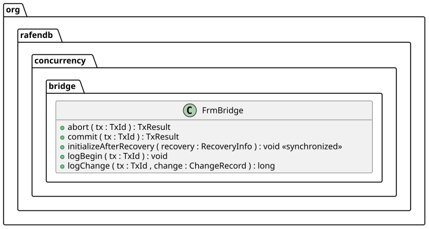
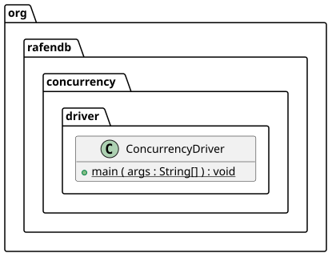
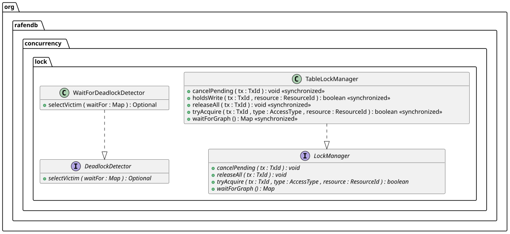
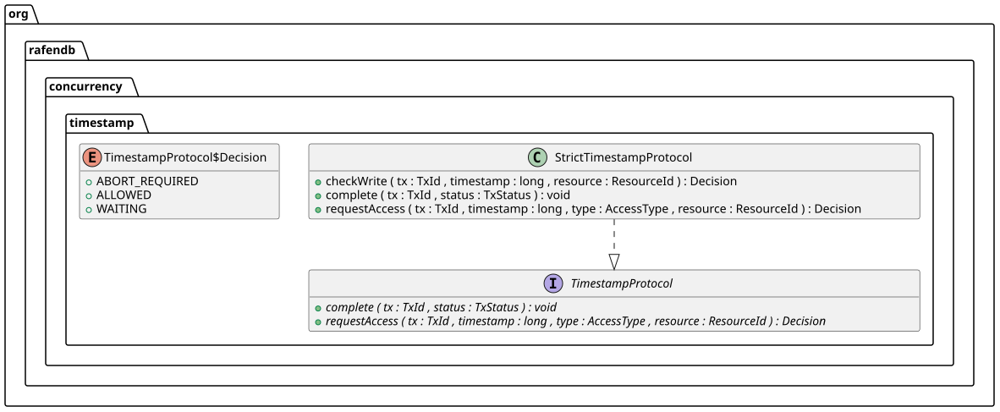
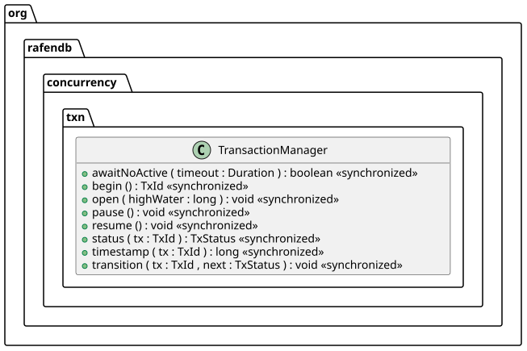
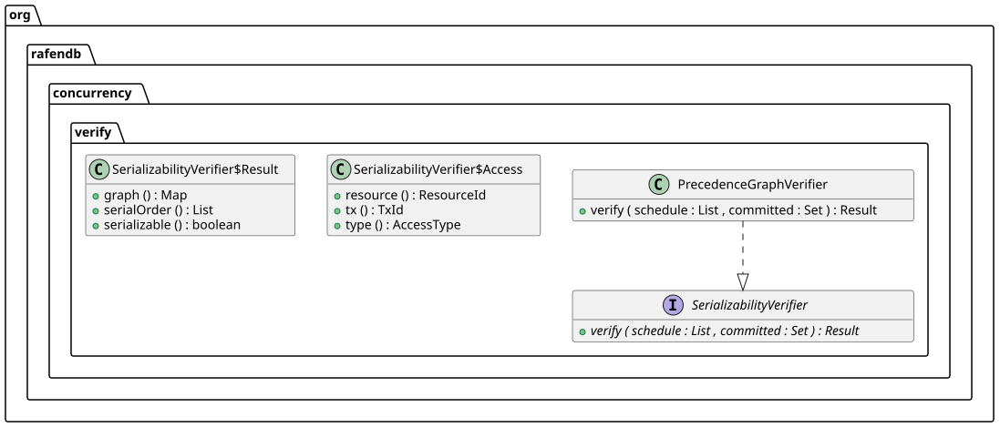
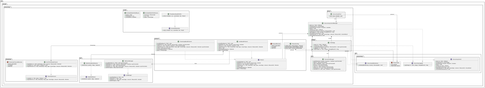
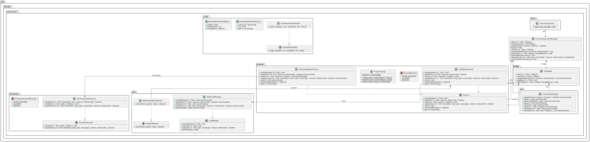

### concurrency-bridge

### concurrency-driver

### concurrency-lock

### concurrency-protocol

### concurrency-timestamp

### concurrency-txn

### concurrency-verify

### concurrency-with-api

### concurrency

