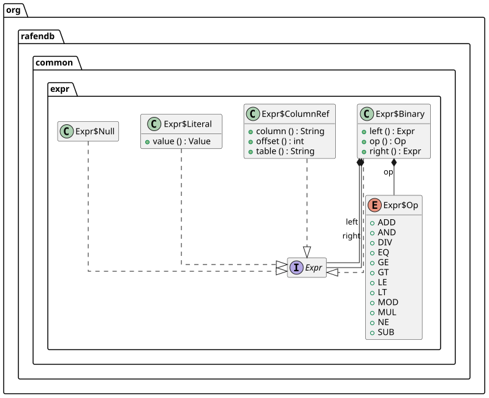
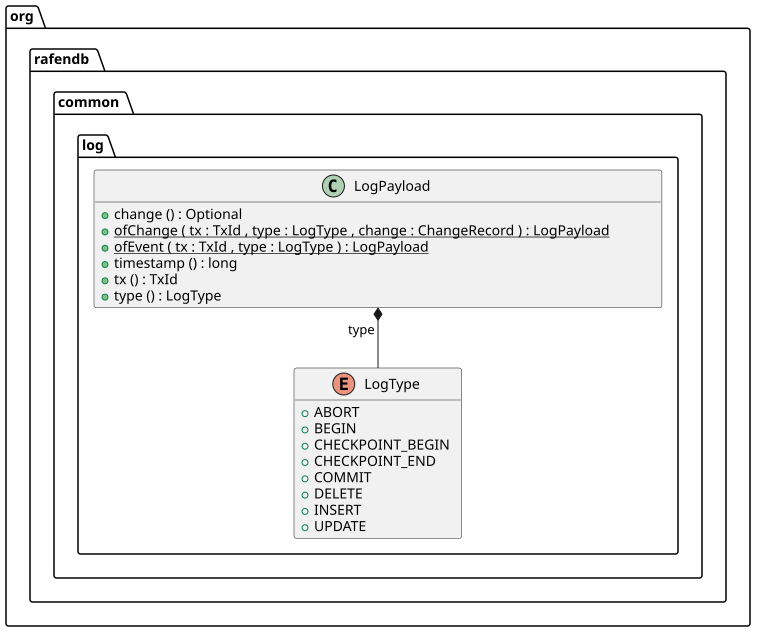
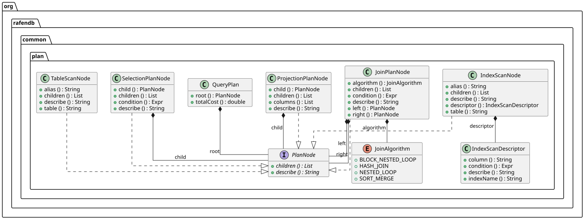
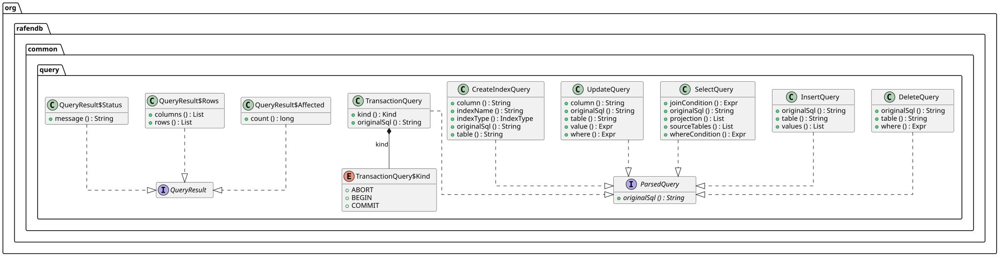
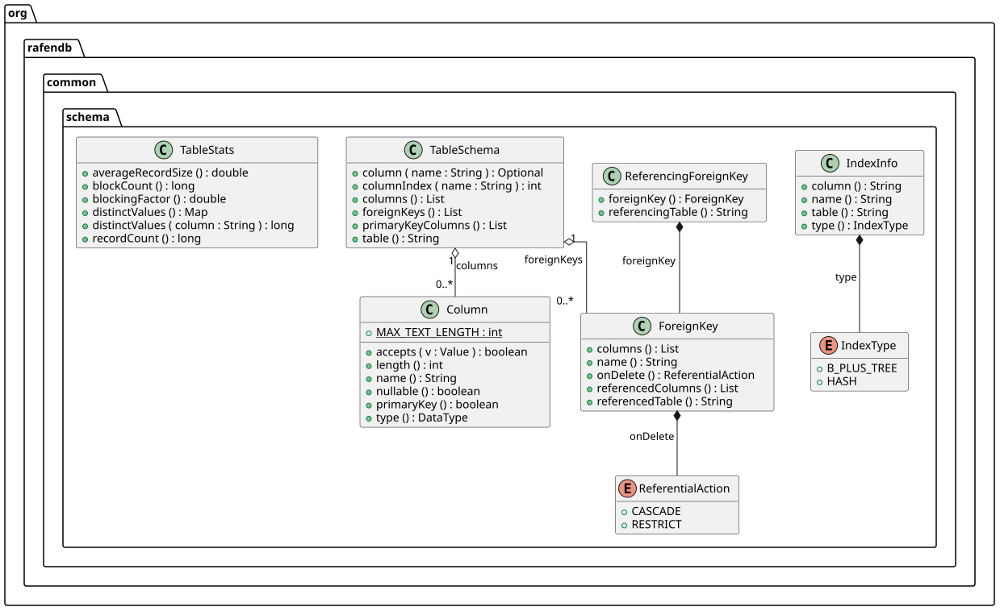
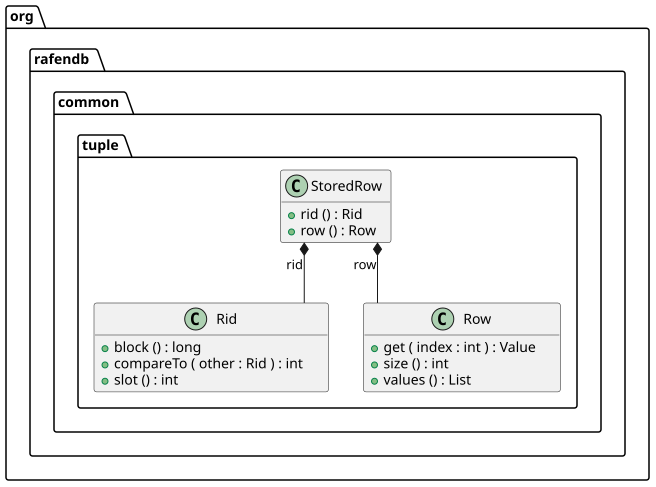
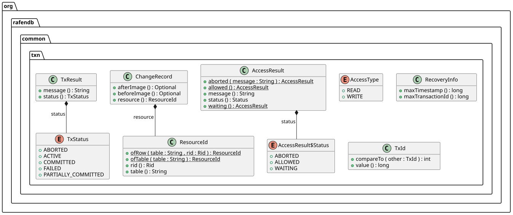
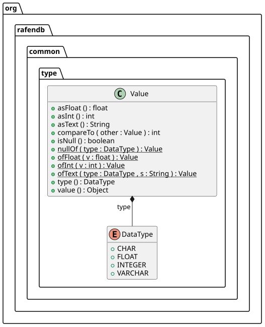

### api-concurrency

### api-optimizer

### api-processor

### api-recovery

### api-storage

### api-with-common

### api

### common-expr

### common-log

### common-plan

### common-query

### common-schema

### common-tuple

### common-txn

### common-type

### common

