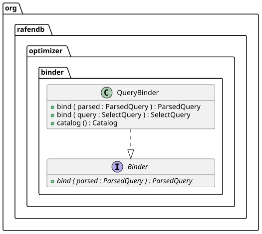
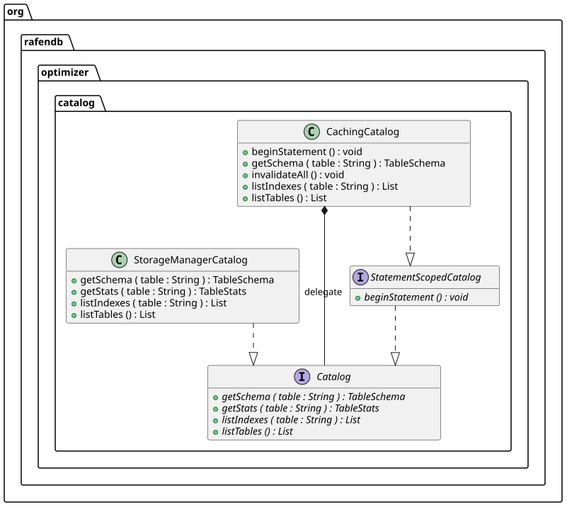
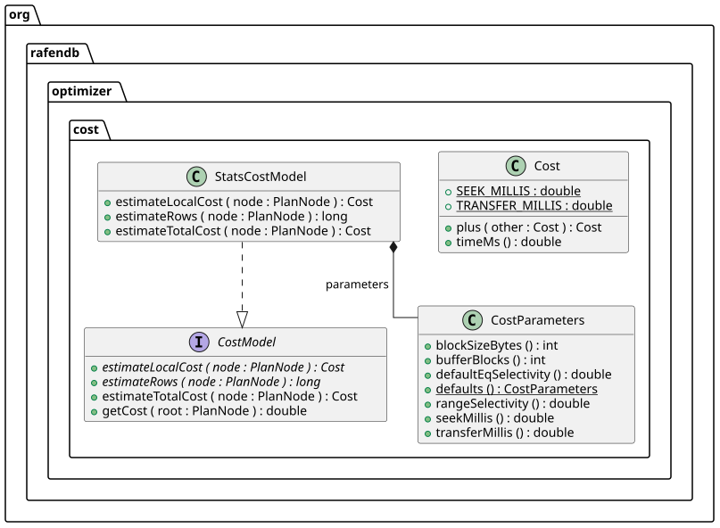
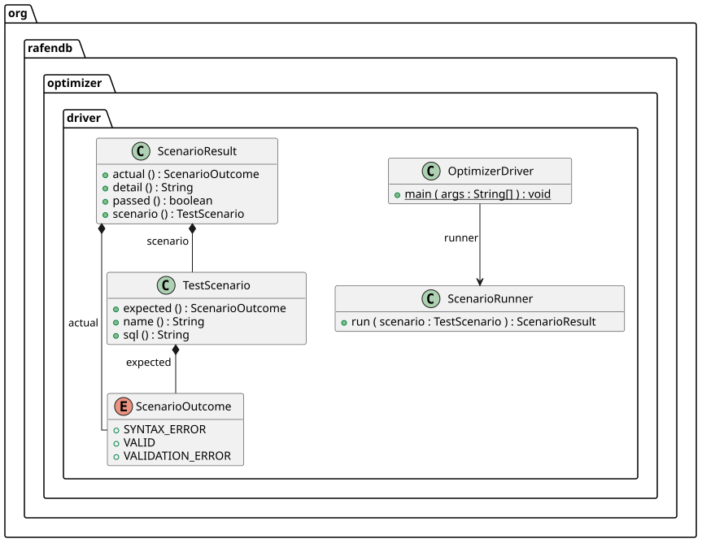
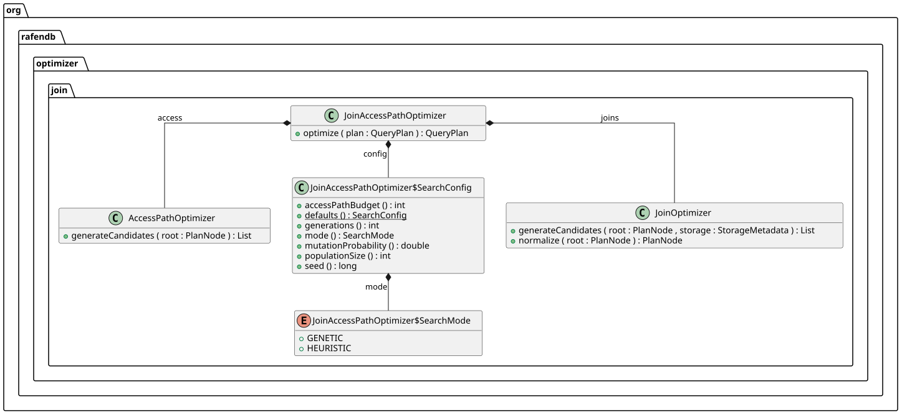
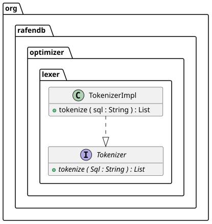
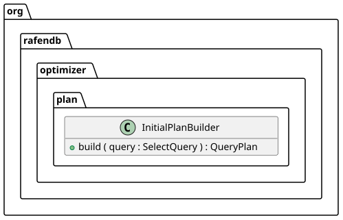
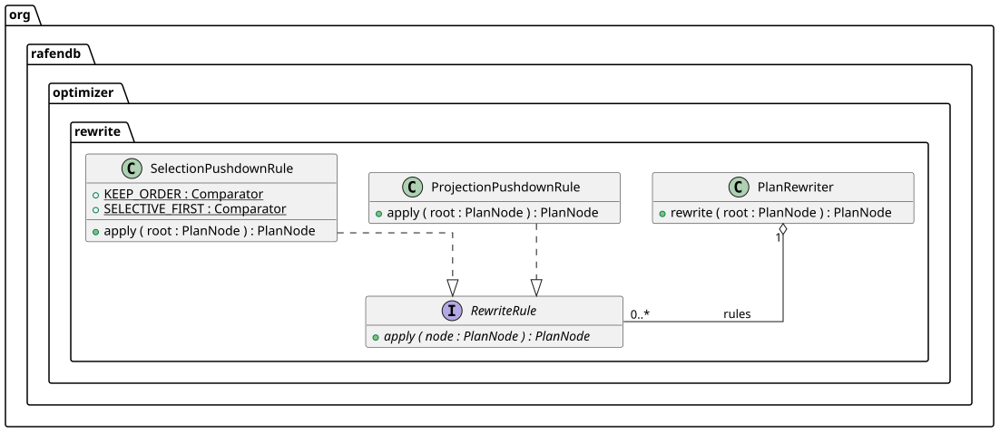
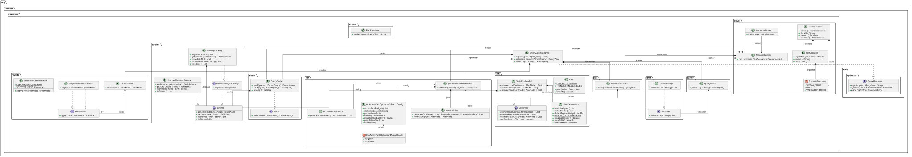
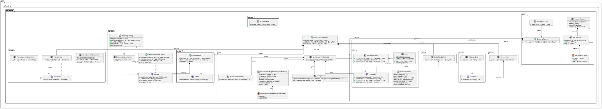

### optimizer-binder

### optimizer-catalog

### optimizer-cost

### optimizer-driver

### optimizer-explain

### optimizer-join

### optimizer-lexer

### optimizer-parser

### optimizer-plan

### optimizer-rewrite

### optimizer-with-api

### optimizer

