### processor-api
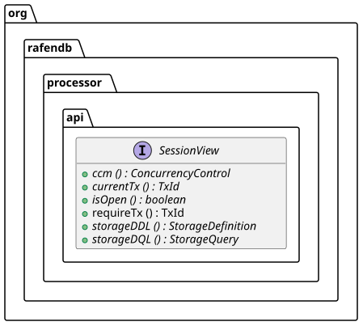

### processor-driver
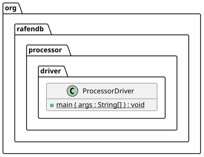

### processor-error
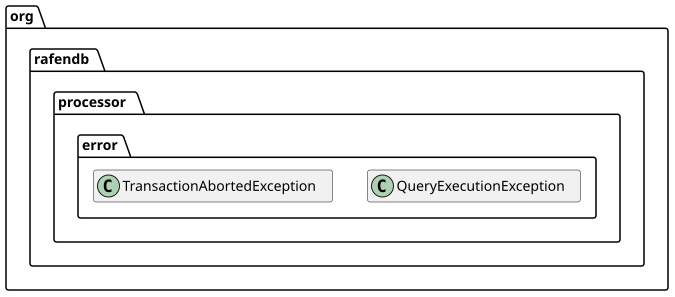

### processor-execution
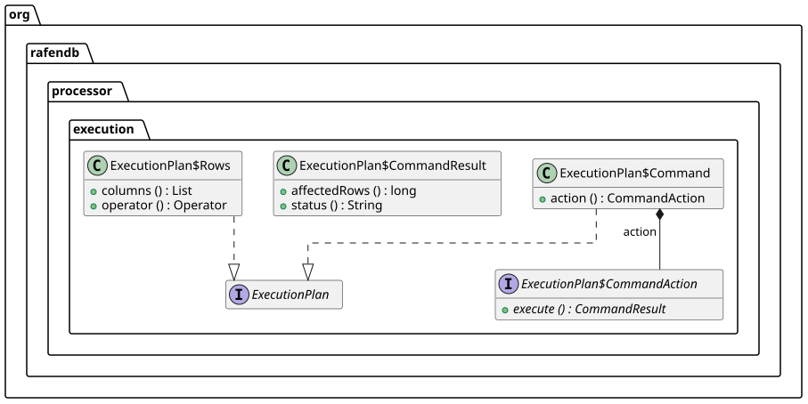

### processor-expr
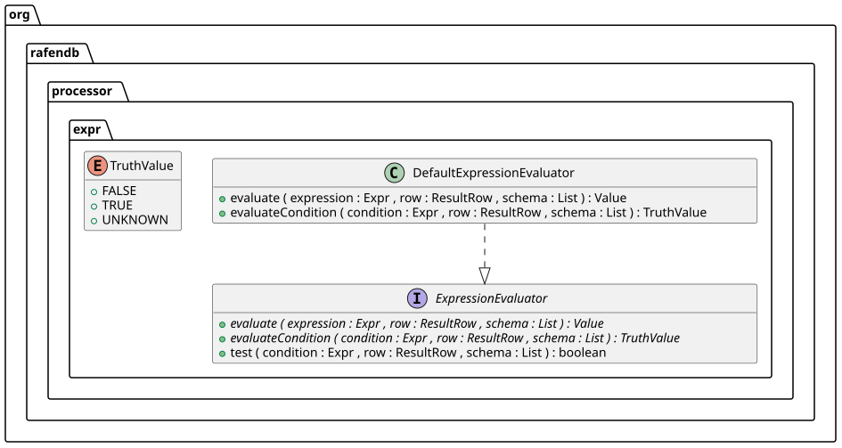

### processor-operator
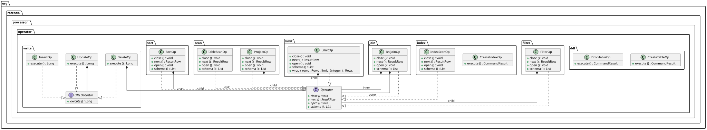

### processor-plan
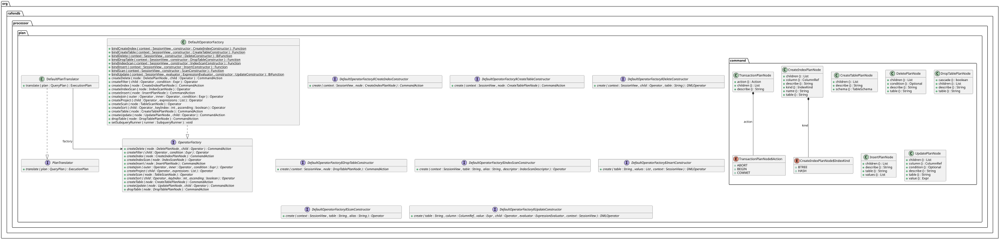

### processor-schema
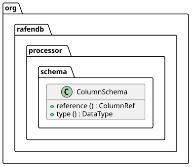

### processor-session
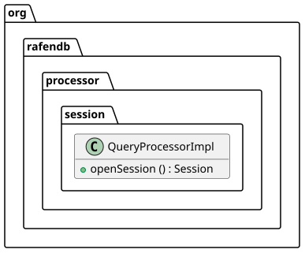

### processor-subquery
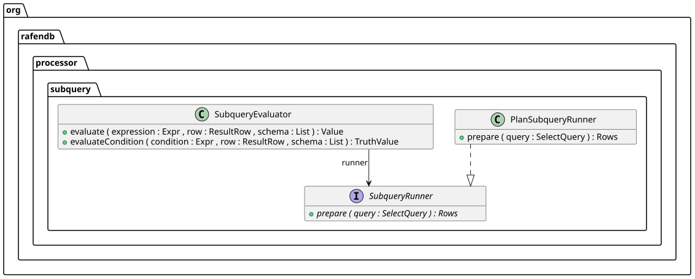

### processor-tuple
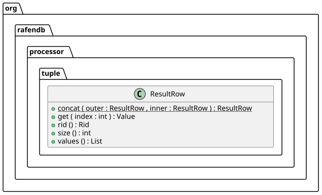

### processor-txn
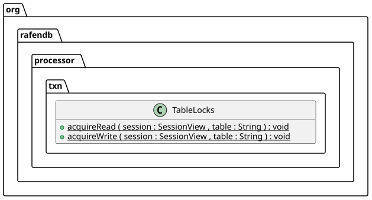

### processor-with-api
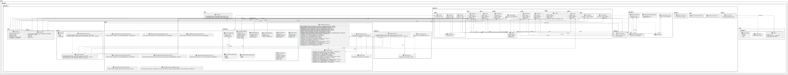

### processor
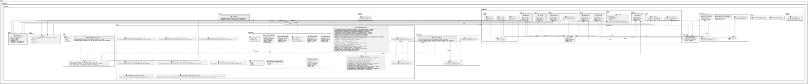
